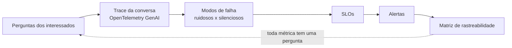

# Plano de observabilidade para um agente de IA em produção

Exercício 15 da disciplina **IA Aplicada com LLMs e Agentes** (Senac), aula de MLOps e observabilidade.

**O problema:** uma loja virtual colocou um agente de IA para decidir trocas de produtos. Ele consulta o pedido, consulta a política e aprova, recusa ou encaminha para um atendente. A promessa ao negócio é **resolver 60% das trocas sem atendente**. A pergunta do exercício é: *como saber se o agente está funcionando, e funcionando bem?*

**A resposta curta:** taxa de erro não basta. A maioria das falhas de um agente é **silenciosa**: ele continua respondendo, só que responde pior. Por isso o plano mede a decisão, não só a infraestrutura.

📄 **[Ler o plano completo](aula15-plano-de-observabilidade.md)** (a entrega do exercício)

---

## Metodologia

O plano segue um caminho que parte do negócio e chega no sinal técnico, nunca o contrário:

| Etapa | Técnica usada | Seção do plano |
|---|---|---|
| Perguntas | Cada pergunta precisa mudar uma decisão de alguém (negócio, operação, quem paga, quem responde). Pergunta que não muda decisão foi cortada. | 1 |
| *Trace* | Convenções semânticas **GenAI do OpenTelemetry**: `invoke_agent` na raiz, filhos `chat` e `execute_tool`, atributos `gen_ai.*` (modelo, tokens, `finish_reasons`, `tool.call.id`, `conversation.id`). | 2 |
| Atributos de negócio | `troca.decisao`, `agente.termino` e `troca.dentro_do_prazo`, com poucos valores para servir de dimensão sem explodir a **cardinalidade**. O prazo é calculado pela aplicação, não pelo modelo. | 2 |
| **Carimbo de versão** | Código (`service.version`), prompt (`agente.versao_prompt`) e modelo (`gen_ai.request.model`), porque cada um pode mudar sozinho. | 2 |
| Modos de falha | Mapa de falhas por componente, classificadas em **ruidosas** (erro, lentidão) e **silenciosas** (excesso de cautela, laço, troca fora da política), cada uma com o sinal que a torna visível. | 3 |
| Objetivos | **SLI, SLO e SLA**, com janela de 28 dias e o denominador definido (conversas bloqueadas por abuso ficam fora da conta). | 4 e anexo A |
| Alertas | Alertas por **taxa de consumo da margem de erro**, com janelas de 3 e 6 horas e volume mínimo, para não acordar ninguém por 4 respostas ruins. | 5 |
| Rastreabilidade | Matriz pergunta → sinal → atributo → quem consome. | 6 |
| Dados | Cálculo de volume, **100% dos traces** sem amostragem, retenção por tipo de dado e identificador do cliente em *hash* (LGPD). | 7 |
| Qualidade | **LLM como juiz** em 5% das conversas e **rótulos implícitos** do atendente (troca desfeita = erro do agente; encaminhamento aprovado sem mudança = cautela demais). Cada erro volta para o *golden dataset*. | 7 |
| Logs e custo | Regra de níveis de log, limite de tokens por usuário e conta de custo por conversa. | anexos B, C e D |

## Métricas e metas

| Indicador | Meta (28 dias) | Por quê |
|---|---|---|
| Conversas com término normal (`agente.termino = respondeu`) | ≥ 95% | saúde operacional |
| Trocas resolvidas sem atendente | ≥ 60% | a promessa do negócio |
| Trocas aprovadas fora da política | < 1% | não cumprir os 60% aprovando o que não devia |
| Turnos respondidos em até 10 s | ≥ 95% | 4 chamadas de 1 a 2 s + ferramentas dão 5 a 7 s; sobra folga |
| Custo médio por conversa | ≤ R$ 0,01 | ~7.800 tokens de entrada e ~320 de saída ≈ R$ 0,005 |

**Salvaguardas de custo e abuso:** orçamento de **6 passos** por conversa e limite de **50 mil tokens por usuário por dia**, com aviso em 80%. Uma conversa normal gasta ~8 mil tokens e a pior possível ~14 mil; o prejuízo máximo de um robô fica em ~R$ 0,03 por dia.

**Volume:** ~500 conversas por dia × 8 *spans* × ~1 KB ≈ 4 MB por dia, o que permite guardar todos os *traces*.

---

## Melhorias identificadas depois da entrega

Revisando o plano com o material das aulas 2 e 3, encontrei dois pontos que eu mudaria. O arquivo da entrega foi mantido como foi avaliado; as melhorias ficam registradas aqui.

**1. Parâmetros no carimbo de versão.** O comportamento de um LLM depende de **prompt × modelo × parâmetros**. O carimbo grava os dois primeiros, mas não os parâmetros da chamada. Se alguém mudar a temperatura ou o limite de saída, a piora aparece no painel sem nenhuma versão diferente para explicar. A correção é gravar em cada `chat`:

| Atributo OpenTelemetry | Por que importa neste agente |
|---|---|
| `gen_ai.request.temperature` | O agente toma uma **decisão** (aprovar, recusar, encaminhar), então a temperatura deve ser baixa e fixa. Mesmo assim, `temperature = 0` não garante saída idêntica, por isso os testes de regressão verificam **propriedades** (a decisão respeita a política?), não igualdade de texto. |
| `gen_ai.request.max_tokens` | `max_tokens` não encurta a resposta, ele corta. Se o limite cair, aparece `finish_reasons = length` e a resposta chega incompleta ao cliente. |
| `gen_ai.response.model` | Ver o próximo ponto. |

**2. O modelo por trás do apelido.** O *trace* usa `mistral-small-latest`, um apelido que o provedor pode apontar para outro modelo sem aviso. Esse é justamente o modo de falha 3 do plano (o agente fica cauteloso demais "sem ninguém ter mudado nada"). Duas saídas: fixar uma **versão datada** do modelo em produção e gravar `gen_ai.response.model`, que registra o modelo que de fato respondeu. Com isso, uma troca silenciosa do provedor vira uma mudança visível no carimbo de versão.

---

## O que aprendi

- **Observar um agente é diferente de observar uma API.** Latência, custo e erro podem continuar normais enquanto a qualidade cai. O sinal que importa é o de negócio (decisão e término), cortado por versão.
- **Toda métrica precisa de uma pergunta e de uma decisão.** A matriz de rastreabilidade obriga a cortar o que ninguém usaria.
- **O denominador importa tanto quanto a meta.** Sem tirar as conversas de abuso, um ataque derrubaria a taxa de resolução sem o agente ter piorado.
- **O que é verificável não deve ficar com o modelo.** O prazo da troca é calculado pela aplicação, o que permite checar 100% das aprovações sem juiz.
- **Alerta é sobre ritmo de consumo da margem, não sobre um evento isolado.** As janelas foram dimensionadas pelo volume real.
- **Custo é uma conta, não um palpite:** tokens por chamada × chamadas por conversa × volume, com limites que seguram o pior caso.
- **O plano é uma hipótese.** Só se confirma provocando as falhas de propósito: pedido fora do prazo, sistema de pedidos fora do ar, modelo lento e usuário estourando o limite.

## Referências

- Material da disciplina: [celsocrivelaro/senac-agentes-llm](https://github.com/celsocrivelaro/senac-agentes-llm), pasta `aula-15-mlops-observabilidade` (e aulas 2 e 3 para parâmetros e versionamento de modelo).
- [OpenTelemetry: Semantic Conventions for Generative AI](https://opentelemetry.io/docs/specs/semconv/gen-ai/)
- [Google SRE Workbook: Alerting on SLOs](https://sre.google/workbook/alerting-on-slos/)
